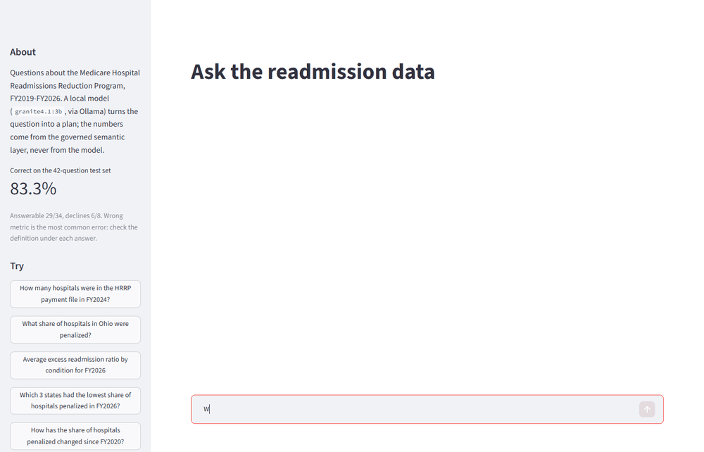
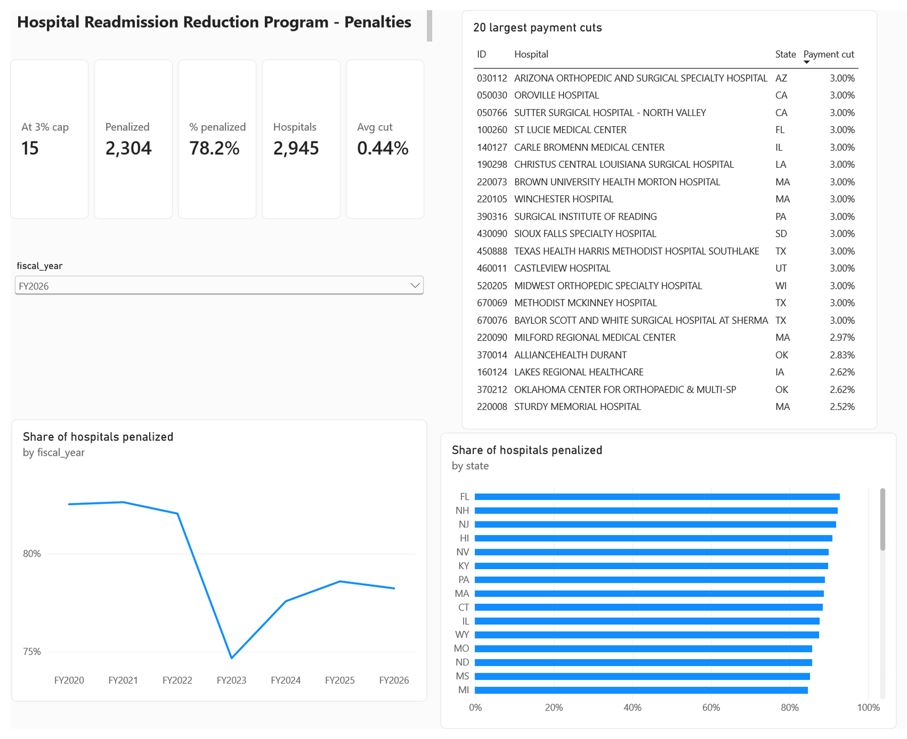
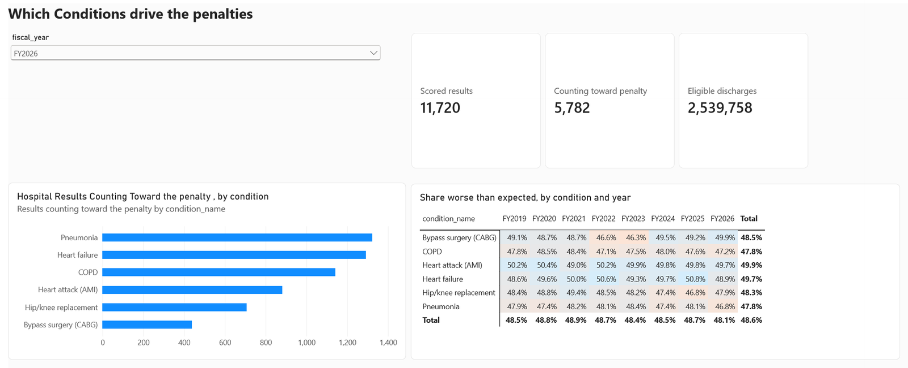
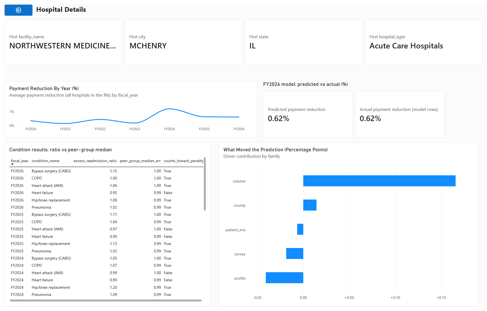
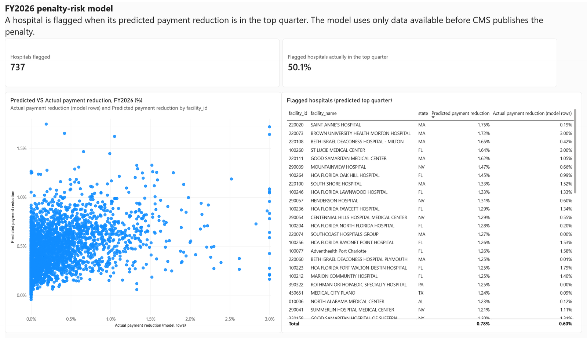

# Hospital Readmission Intelligence

Which US hospitals will Medicare penalize for readmissions, why, and can you trust the answer?
A tested data pipeline, a penalty-risk model, a Power BI dashboard and an AI assistant, all on
**real public CMS, CDC and Census data** for about 3,000 hospitals (no patient-level data).

[Code on GitHub](https://github.com/Saikrishna0107/Healthcare-readmission-intelligence) ·
[Case study](case_study.md) · [Decision log](decisions.md) · [Model card](model_card.md) ·
[How it was built](https://github.com/Saikrishna0107/Healthcare-readmission-intelligence#how-it-was-built-step-by-step)

## The problem

Medicare's **Hospital Readmissions Reduction Program (HRRP)** cuts up to **3% of a hospital's
Medicare base payments** when too many patients come back within 30 days of discharge for
heart attack, heart failure, pneumonia, COPD, hip/knee replacement or bypass surgery. In
FY2026, 78% of the hospitals in the program were penalized.

The project answers three questions a hospital or health plan analyst gets asked:

1. **Who is penalized, and by how much?** Every hospital's cut, recomputed from CMS's own inputs.
2. **Why?** Which drivers (patient experience, hospital profile, community health) go with
   higher penalties.
3. **Who is at risk next?** A model that ranks hospitals by expected penalty, tested on a year
   it never saw.

## Headline findings

- **The penalty formula is reproduced exactly.** All 21,263 hospital-years from FY2020 to FY2026
  match CMS's published payment reduction within 0.01 percentage points. FY2026: 2,304 of 2,945
  hospitals penalized (78%), 15 at the 3% cap.
- **Discharge planning goes with fewer readmissions, every year.** Hospitals in the lowest
  quarter of "care transition" survey scores average a heart-failure excess readmission ratio
  of 1.020-1.032; the top quarter 0.979-0.985, in each year from FY2020 to FY2026
  (association, not causation).
- **Poverty barely moves the penalty** (rank correlation -0.03), because CMS compares each
  hospital only with peers serving a similar share of low-income patients.
- **The risk model finds twice as many top-quarter penalties as chance.** LightGBM reaches an
  AUC of 0.745 on FY2026; half of the hospitals it flags really land in the top quarter. A
  random train/test split would have reported 0.776, because neighbouring years share patients.
- **The AI assistant is right 83% of the time on 42 test questions, and shows its work.** A
  local model writes a query plan; the numbers come from a governed semantic layer, never from
  the model. Wrong metric choice is its most common error, and it is reported, not hidden.
- **The dashboard checks itself.** Every Power BI DAX measure is compared with the semantic
  layer for every year: 0 mismatches in 136.

## See it

**Ask the data in plain English** (local model, nothing leaves the computer; the wait is
shortened in the recording, the real time is shown under the answer):

Under each answer: the metric's definition, the plan the model wrote, and the SQL that ran
([full view](images/agent_how_answered.png)).

**Power BI dashboard** (five pages, [how they were built](powerbi_guide.md)):

| Penalties: who, how much, where | Conditions: which ones drive penalties |
|---|---|
|  |  |
| **Hospital detail** (drill-through): every result vs its peer median, and what moved the model | **Model risk**: predicted vs actual penalty, and the flagged hospitals |
|  |  |

The fifth page, [Checks](images/dashboard_checks.png), compares every DAX measure with the semantic
layer for every year (0 mismatches).

## Notebooks (with results)

- [01 · Data exploration](notebooks/01_data_exploration.html): what each dataset contains, its
  traps, and what they mean for the project.
- [02 · Modeling data](notebooks/02_modeling_data.html): the target, the overlap trap, the
  validation design and which drivers carry signal, before any model is trained.
- [03 · Model results](notebooks/03_model_results.html): the models against baselines on a test
  year that shares no patients with training, and what drives their predictions.

## Project documents

- [Case study](case_study.md): the problem, the data traps, what was built and found, and what
  did not work, in a five-minute read.
- [Decision log](decisions.md): every major decision, the reasoning and the alternatives considered.
- [Model card](model_card.md): what the penalty-risk model is for, how it was tested, and its limits.
- [Power BI guide](powerbi_guide.md): how the dashboard pages were built, and the traps on the way.

## Built with

Python 3.12 · DuckDB · dbt and MetricFlow · LightGBM, EBM and SHAP · Ollama · Streamlit ·
Power BI (PBIP, TMDL, DAX) · marimo · pytest · GitHub Actions
